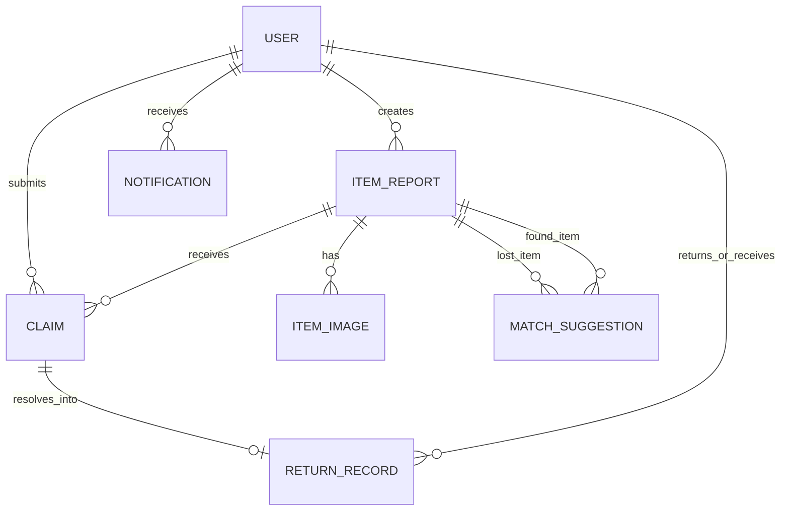

# CampusFind – College Lost & Found Portal

**CampusFind** is a secure, full-stack, backend-driven web application tailored for college campuses. It bridges the gap between students who lose items, good Samaritans who find belongings, and campus security staff who verify ownership and execute safe handovers.

---

## 🏛️ UI & Design System

The application features a modern, responsive design inspired by academic excellence:
- **Primary Navy Blue**: `#002B5C` (Top navbar, headers, primary buttons)
- **Secondary Blue**: `#003B7A` (Card headers, active links)
- **Gold / Yellow Accent**: `#F9C300` (Call-to-action buttons: *Report Lost*, *Report Found*, *Submit Claim*, match indicators)
- **Light Background**: `#F7F9FC`
- **White Cards**: `#FFFFFF` with smooth shadows and rounded corners
- **Status Badges**:
  - **Open**: Blue (`#EFF6FF`)
  - **Possible Match**: Orange (`#FFF7ED`)
  - **Claim Requested**: Yellow (`#FEFCE8`)
  - **Claimed / Approved**: Green (`#F0FDF4`)
  - **Rejected**: Red (`#FEF2F2`)
  - **Returned**: Dark Green (`#ECFDF5`)

---

## 🏗️ Folder Structure

```
campusfind/
├── README.md
├── campusfind-backend/
│   ├── pom.xml                                  # Spring Boot 3 Maven config
│   ├── mvnw / mvnw.cmd                          # Maven wrapper executables
│   └── src/main/
│       ├── java/com/campusfind/
│       │   ├── CampusFindApplication.java       # Main entrypoint
│       │   ├── config/
│       │   │   ├── SecurityConfig.java          # JWT filter & RBAC rules
│       │   │   ├── SwaggerConfig.java           # OpenAPI 3 docs & Bearer auth
│       │   │   └── WebMvcConfig.java            # CORS & Upload directory mapping
│       │   ├── controller/
│       │   │   ├── AuthController.java          # Login & Registration
│       │   │   ├── UserController.java          # Profile management
│       │   │   ├── ItemReportController.java    # Lost & Found reports CRUD, search, upload
│       │   │   ├── ClaimController.java         # Ownership claim submission & tracking
│       │   │   ├── MatchController.java         # Match suggestions & admin confirmation
│       │   │   ├── AdminController.java         # Dashboard analytics & return handovers
│       │   │   └── NotificationController.java  # In-app alerts & read status
│       │   ├── dto/
│       │   │   ├── request/                     # Validated Request DTOs
│       │   │   └── response/                    # Typed Response DTOs & ApiResponse wrapper
│       │   ├── entity/                          # JPA Entities (User, ItemReport, Claim, etc.)
│       │   ├── exception/                       # Custom Exceptions & GlobalExceptionHandler
│       │   ├── repository/                      # Spring Data JPA Repositories
│       │   ├── security/                        # JwtTokenProvider, Filter, UserPrincipal
│       │   └── service/                         # Business logic interfaces & implementations
│       └── resources/
│           ├── application.properties           # Database, JWT, multipart, & email configs
│           └── schema-and-sample-data.sql       # Full DDL schema and demo dataset
└── campusfind-frontend/
    ├── package.json
    ├── vite.config.js                           # Vite dev server & API proxy
    ├── index.html
    └── src/
        ├── App.jsx & main.jsx                   # React Router & Providers
        ├── index.css & App.css                  # Custom Navy/Gold design system
        ├── context/
        │   ├── AuthContext.jsx                  # JWT auth state & user session
        │   └── NotificationContext.jsx          # Live alert polling & badges
        ├── services/
        │   ├── api.js                           # Axios instance with JWT interceptor
        │   ├── authService.js
        │   ├── itemService.js
        │   ├── claimService.js
        │   ├── matchService.js
        │   └── adminService.js
        ├── components/
        │   ├── Navbar.jsx                       # Navy topbar with branding & notifications
        │   ├── Footer.jsx
        │   ├── ProtectedRoute.jsx               # Role-based route guard
        │   ├── StatusBadge.jsx                  # Color-coded status badges
        │   ├── ItemCard.jsx                     # Report display card
        │   ├── MatchCard.jsx                    # Score & attribute match card
        │   ├── ClaimModal.jsx                   # Private ownership proof submission
        │   ├── ReturnModal.jsx                  # Handover confirmation & register record
        │   ├── ImageUploader.jsx                # Drag-and-drop multipart uploader
        │   ├── StatCard.jsx                     # Analytics metric card
        │   └── ConfirmDialog.jsx                # Safe delete confirmation modal
        └── pages/
            ├── HomePage.jsx                     # Hero section, categories, workflow, recent items
            ├── LoginPage.jsx                    # Login with 1-click Demo credentials
            ├── RegisterPage.jsx                 # Student & Admin registration
            ├── StudentDashboard.jsx             # Metrics, my reports, matches, claim timeline
            ├── ReportLostPage.jsx               # Lost item form with private marks
            ├── ReportFoundPage.jsx              # Found item form with custody location
            ├── SearchItemsPage.jsx              # Filter by keyword, category, colour, date, type
            ├── ItemDetailPage.jsx               # Detailed report, match list, claim actions
            ├── MyReportsPage.jsx                # Tabbed report management
            ├── MyClaimsPage.jsx                 # Claim status tracker & staff notes
            ├── AdminDashboard.jsx               # Staff analytics & pending queue
            ├── AdminClaimsPage.jsx              # Approve/reject & trigger return handover
            ├── AdminReportsPage.jsx             # Comprehensive directory & status overrides
            └── ProfilePage.jsx                  # Student/Staff profile editor & stats
```

---

## 🗄️ Database Schema & Entity Relationships



### Entity Explanations:
1. **`users` (`User`)**: Stores student and staff accounts (`ROLE_STUDENT`, `ROLE_ADMIN`), hashed BCrypt passwords, college ID, and email.
2. **`item_reports` (`ItemReport`)**: Central table for missing or recovered belongings. Differentiates `type` (`LOST` / `FOUND`), tracks custody location (`item_held_at`), and protects `unique_marks`.
3. **`item_images` (`ItemImage`)**: Stores local or S3 image URLs linked to specific item reports.
4. **`claims` (`Claim`)**: Submitted by students claiming a found item. Stores **`private_ownership_proof`** (confidential), admin review notes, and approval status.
5. **`match_suggestions` (`MatchSuggestion`)**: Links a `lost_item_id` and `found_item_id` with an algorithm similarity score (0–100%) and matched attribute breakdown.
6. **`return_records` (`ReturnRecord`)**: Permanent audit record created upon physical handover. Records recipient student, handing security officer, handover location, timestamp, and verification method.
7. **`notifications` (`Notification`)**: Real-time alerts for students when a potential match is found or when a claim status changes.

---

## 🔒 Privacy & Security Protocol

- **Public Masking**: Publicly accessible API views do not expose confidential identification marks, student phone numbers, or secret details.
- **Claim Verification**: When filing an ownership claim, students must provide private details (such as wallpaper description, hidden contents, scratch locations, or last 4 digits of document numbers).
- **Access Control**: Ownership proof is visible **only** to the claimant and authorized campus security/admin staff.
- **Physical Verification**: Handover requires biometric, student UID, or physical device unlock confirmation.

---

## ⚡ Rule-Based Matching System

When any new item report is created or updated, the backend matching algorithm compares it with opposite-type open items:
- **Category Match**: $+35\%$ for exact category match.
- **Title Keyword Overlap**: Up to $+25\%$ based on token intersection and string similarity.
- **Colour Match**: $+15\%$ for colour keyword match.
- **Location Proximity**: $+15\%$ for matching campus zones (e.g., Central Library, Block A, Cafeteria).
- **Date Proximity**: $+10\%$ if found date $\ge$ lost date and occurred within 14 days.

Matches with a score $\ge 40\%$ automatically generate a `MatchSuggestion` record and send instant in-app and email notifications.

---

## 📡 REST API Reference

### 1. Authentication & Profile
| Method | Endpoint | Description | Auth |
| :--- | :--- | :--- | :--- |
| `POST` | `/api/auth/register` | Register new student or staff | Public |
| `POST` | `/api/auth/login` | Authenticate and obtain JWT token | Public |
| `GET` | `/api/users/profile` | Get current authenticated user profile | Authenticated |
| `PUT` | `/api/users/profile` | Update student profile details | Authenticated |

### 2. Item Reports
| Method | Endpoint | Description | Auth |
| :--- | :--- | :--- | :--- |
| `GET` | `/api/items` | List items (optional `?type=LOST\|FOUND`) | Public |
| `POST` | `/api/items` | Create Lost or Found item report | Authenticated |
| `GET` | `/api/items/{id}` | Get item details (masks private marks for non-owners) | Public |
| `PUT` | `/api/items/{id}` | Update item report | Owner / Admin |
| `DELETE` | `/api/items/{id}` | Delete item report | Owner / Admin |
| `GET` | `/api/items/search` | Search by category, keyword, colour, location, dates | Public |
| `GET` | `/api/my-reports` | List reports submitted by logged-in student | Authenticated |
| `POST` | `/api/items/upload-image` | Upload image file (Multipart form-data) | Authenticated |
| `PATCH` | `/api/items/{id}/status` | Update item report status | Owner / Admin |

### 3. Claims & Handover
| Method | Endpoint | Description | Auth |
| :--- | :--- | :--- | :--- |
| `POST` | `/api/claims` | Submit ownership claim with private proof | Authenticated |
| `GET` | `/api/claims/my-claims` | List claims submitted by logged-in student | Authenticated |
| `GET` | `/api/claims/{id}` | View claim details | Claimant / Admin |
| `GET` | `/api/claims/item/{id}` | View all claims on a found item | Finder / Admin |
| `PUT` | `/api/admin/claims/{id}/approve` | Approve claim with staff notes | Admin |
| `PUT` | `/api/admin/claims/{id}/reject` | Reject claim with reason | Admin |
| `POST` | `/api/admin/return-records` | Record official handover & close item | Admin |
| `GET` | `/api/admin/return-records` | List all item return records | Admin |

### 4. Admin & Analytics
| Method | Endpoint | Description | Auth |
| :--- | :--- | :--- | :--- |
| `GET` | `/api/admin/dashboard` | Get counts, category distribution, hotspots, queue | Admin |
| `GET` | `/api/admin/claims` | Get all claims across campus | Admin |
| `GET` | `/api/admin/reports` | Get all reports across campus | Admin |

---

## 🚀 Setup & Execution Guide

### Prerequisites
- **Java**: JDK 17 or higher
- **Node.js**: Node 18+ and npm
- **Database**: MySQL 8.0+

---

### Step 1: Database Setup
1. Open your MySQL client (MySQL Workbench, phpMyAdmin, or terminal CLI).
2. Execute the script located at:
   ```
   campusfind-backend/src/main/resources/schema-and-sample-data.sql
   ```
   *(This creates the `campusfind_db` database, all relational tables, and pre-seeds realistic demo items, users, and claims).*

---

### Step 2: Run Spring Boot Backend
1. Open terminal in `campusfind/campusfind-backend`:
   ```bash
   cd campusfind-backend
   ```
2. Verify database username/password in `src/main/resources/application.properties`:
   ```properties
   spring.datasource.username=root
   spring.datasource.password=root
   ```
3. Run the application using Maven:
   ```bash
   mvn spring-boot:run
   ```
   *Or with wrapper:*
   ```bash
   ./mvnw spring-boot:run
   ```
4. Backend API will start on: **`http://localhost:8080`**
5. Interactive OpenAPI Swagger UI is available at: **`http://localhost:8080/swagger-ui.html`**

---

### Step 3: Run React Frontend
1. Open a new terminal in `campusfind/campusfind-frontend`:
   ```bash
   cd campusfind-frontend
   ```
2. Install npm dependencies:
   ```bash
   npm install
   ```
3. Start Vite development server:
   ```bash
   npm run dev
   ```
4. Open your browser at: **`http://localhost:5173`**

---

## 👥 Demo Test Accounts

| Role | Email | Password | Details |
| :--- | :--- | :--- | :--- |
| **Admin / Security Staff** | `admin@campus.edu` | `password123` | Full access to staff dashboard, claims queue, analytics, return handovers |
| **Student 1** | `aarav.patel@campus.edu` | `password123` | Has active Lost report (AirPods) and match suggestions |
| **Student 2** | `rohan.verma@campus.edu` | `password123` | Has approved ID card claim and return record |
| **Student 3** | `sneha.reddy@campus.edu` | `password123` | Has active Wildcraft backpack report |

*(You can also use the **Quick Demo Buttons** directly on the Login page for 1-click authentication!)*

---

## 🔮 Future Enhancements Roadmap

1. **AI Image Matching**: Integration with computer vision embedding models (CLIP / ResNet) to compare item visual similarity and color tone automatically.
2. **AWS S3 Storage**: Seamless switch from local `uploads/` directory to AWS S3 / Cloudflare R2 bucket.
3. **Campus Email OTP**: 2-Factor authentication via campus email OTP during registration and claim handover.
4. **QR Code Handover Confirmation**: Generation of secure one-time QR codes scanned by security staff upon physically returning items.
